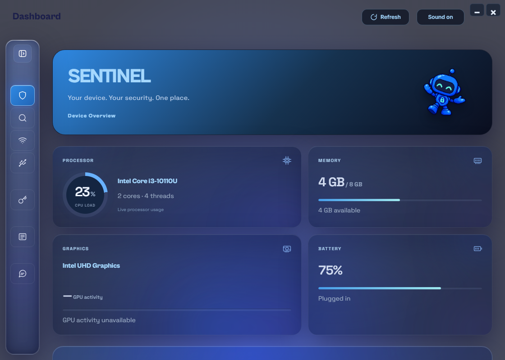
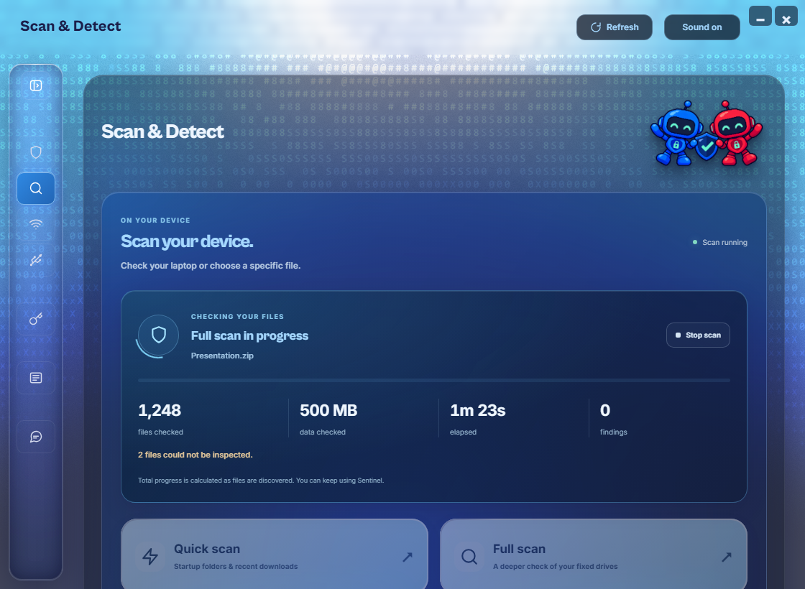
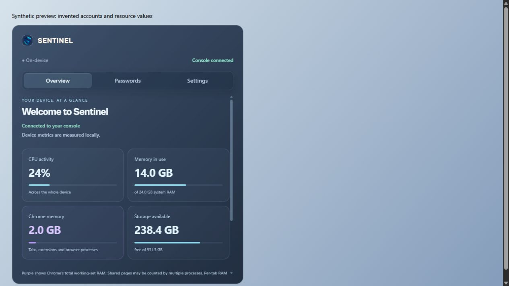

<div align="center">


# Sentinel

### Understand the warning. Protect what matters.

A local-first Windows security companion with file inspection, encrypted passwords, browser awareness, and on-device AI.

[](#requirements)
[](#browser-companion)
[](LICENSE)
[](https://github.com/LoopTryx/Sentinel/actions/workflows/ci.yml)

[**Get Sentinel**](https://github.com/LoopTryx/Sentinel/releases) · [Changelog](CHANGELOG.md) · [Architecture](docs/architecture.md) · [Contribute](CONTRIBUTING.md) · [Report a problem](https://github.com/LoopTryx/Sentinel/issues)

</div>



*Desktop interface preview with synthetic device metrics. Screenshots demonstrate layout, not live protection or measured detection accuracy. [Capture details](docs/images/README.md).*

## One workspace for everyday security

Sentinel brings file inspection, browser warnings, password tools, and security explanations into one Windows desktop application. Local processing handles supported tasks on your computer; optional online analysis is a separate, consented feature.

| Workspace | What it does |
|---|---|
| **Scan & Detect** | Inspect selected files and folders, run supported scan modes, monitor downloads, follow progress, cancel work, and review incomplete results. |
| **Passwords** | Browse saved account metadata, manage an encrypted local vault, generate passwords, and authorize sensitive operations with Windows Hello. |
| **Browser companion** | Connect Chrome to the desktop, show device metrics, provide supported save/autofill flows, and display opted-in link and message warnings. |
| **SentinelAI** | Ask security questions, explore findings, continue a conversation, and keep encrypted chat history locally across app restarts. |
| **Quarantine** | Isolate supported findings in encrypted storage with identity checks and recovery bookkeeping. |
| **Device & USB** | View device information and USB observations; inspect accessible storage. Device-policy and driver experiments have separate qualification gates. |

### Scan & Detect



*Demonstration scan state with invented counters and filenames.*

The Rust inspection core supports **YARA-X rules, SHA-256 matching, static heuristics, and entropy analysis**. The persistent protection worker integrates **ClamAV's native signature engine**. Different workflows use different layers; no single clean result proves a file safe. Heuristic suspicion alone does not authorize automatic quarantine.

### Browser companion



*Companion preview using synthetic resource values.*

The companion connects through Chrome Native Messaging and authenticated local requests. Supported Gmail, Outlook, and WhatsApp adapters provide message awareness and local explanations. Site-specific permissions are opt-in, and changing website layouts can affect coverage.

The overview distinguishes total system memory from **aggregate Chrome process memory**. It does not claim exact per-tab RAM measurement.

## Install

1. Open [GitHub Releases](https://github.com/LoopTryx/Sentinel/releases) and select the current **v1.0.0** release when available. Older **0.x** releases are archived previews.
2. Download `Sentinel-v1.0.0-Setup.exe` and its `SHA256SUMS.txt`.
3. Verify the download, then run Setup. It guides platform and prerequisite checks; WebView2 setup may need internet access.
4. Follow the Chrome companion instructions. Chrome may require one-time user approval to enable it.
5. Open Sentinel and enable only the browser features you want to use.

```powershell
Get-FileHash .\Sentinel-v1.0.0-Setup.exe -Algorithm SHA256
```

Compare the result with the matching entry in `SHA256SUMS.txt`. The single installer includes the application and prepared runtime/model assets; users do not need to manage a separate payload ZIP.

### Requirements

| Requirement | Supported configuration |
|---|---|
| Operating system | Windows 10 build 19041 or newer, or Windows 11 |
| Architecture | x64; this installer is not an ARM64 or 32-bit build |
| Desktop runtime | .NET Framework 4.8 and Microsoft Edge WebView2 |
| Browser | Google Chrome for companion features |
| Identity verification | Windows Hello for sensitive password actions |
| Network | Initial prerequisite downloads, signature updates, browser sites, and optional online AI |

Keep Microsoft Defender enabled. The installer is not claimed to be Authenticode-signed. Check the release notes for current installation and compatibility evidence.

## Privacy and security

- **Passwords:** AES-256-GCM protects vault contents; Windows DPAPI protects the stored per-user secret. Windows Hello authorizes sensitive operations.
- **Conversations:** AI history uses a separate encrypted local store and survives ordinary application restarts.
- **Local AI:** Quantized models run through llama.cpp on the CPU for supported local tasks.
- **Optional Think mode:** NVIDIA NIM provides online analysis with provider configuration and the applicable consent flow.
- **Release hygiene:** Real accounts, passwords, chats, pairing tokens, browser profiles, and owner-specific runtime state are excluded from release payloads.

Local-first does not mean every optional operation is offline. It also does not establish protection against every process already running as your Windows user or an administrator. See [SECURITY.md](SECURITY.md) for boundaries and private vulnerability reporting.

## How it is built

| Layer | Technology and responsibility |
|---|---|
| Security components | **Rust**: inspection, scanning, quarantine, contracts, and runtime foundations |
| Windows application | **C# / WPF / WebView2**: native window, Windows integration, approvals, and connector |
| Interface | **React / TypeScript / Vite / Tailwind CSS**: desktop and shared companion workspaces |
| Local orchestration | **Node.js**: authenticated routes, application state, and AI lifecycle |
| Chrome extension | **JavaScript / Manifest V3**: browser integration and supported page adapters |
| Local AI runtime | **llama.cpp / GGUF models**: CPU inference |
| Records and encryption | **SQLite / AES-256-GCM / Windows DPAPI** |

The installed desktop shell is **WPF + WebView2**. Earlier Tauri planning documents remain engineering history, not a description of the current Windows executable. [Read the architecture](docs/architecture.md).

## Develop

Install Node.js, the repository's pinned pnpm version, and the Rust toolchain specified in `rust-toolchain.toml`.

```powershell
git clone https://github.com/LoopTryx/Sentinel.git
cd Sentinel
pnpm install --frozen-lockfile
pnpm --filter @sentinel/ui build
node apps/extension/scripts/build.mjs
./tools/verify.ps1
```

Native Windows packaging also requires .NET Framework build tools, the official WebView2 SDK, and prepared third-party scanner/model assets. Follow [release building](docs/releases/building.md); a frontend build alone does not produce a complete installed scanner.

<details>
<summary><strong>Repository map</strong></summary>

| Path | Responsibility |
|---|---|
| `apps/ui` | React console and shared companion vault UI |
| `apps/desktop` | Windows host, native connector, approvals, and installer |
| `apps/extension` | Chrome companion and page adapters |
| `apps/demo-runtime` | Local backend and AI orchestration; legacy directory name |
| `crates` | Rust security and runtime components |
| `packages/contracts` | Generated cross-component TypeScript contracts |
| `tools` | Build, verification, packaging, and gated qualification tooling |
| `docs` | Architecture, release provenance, and engineering evidence |

</details>

## Troubleshooting

| Symptom | First check |
|---|---|
| Chrome says the extension context was invalidated | Refresh the affected website after reloading or updating the extension. |
| Companion cannot connect | Open Sentinel, confirm the companion is enabled, then use Reconnect. |
| Metrics show unavailable | Check the native connector connection; unavailable readings do not indicate zero usage. |
| Windows Hello is unavailable | Configure a supported Hello method in Windows. Do not expect secret actions to bypass verification. |
| Scanner is preparing or unavailable | Read the displayed error and definition status. Do not interpret a failed scan as a clean result. |

For a bug report, include your Sentinel, Windows, and Chrome versions plus harmless reproduction steps. Remove personal data from screenshots and logs. [Open an issue](https://github.com/LoopTryx/Sentinel/issues/new/choose).

## Scope and verification

Sentinel complements existing Windows protection. It does **not** promise complete malware detection, universal autofill compatibility, or complete protection against USB attacks. A storage scan cannot establish firmware or keyboard-interface safety. Experimental USB/HID enforcement is separately gated and must not be tested casually on a daily-use machine.

Automated tests, interface previews, installed-browser acceptance, and device qualification are different evidence. See the release verification report and [implementation records](STATUS.md) for what was actually exercised.

## Releases and contribution

The original v1/v2/v3 previews are now **v0.1.0 / v0.2.0 / v0.3.0**. The current consolidated release line is **v1.0.0**. Original commits and authors are preserved; unavailable historical v4/v5 packages are documented rather than recreated under old labels. [Version migration](docs/releases/version-migration.md) · [Changelog](CHANGELOG.md).

Contributions are welcome through scoped issues and reviewed pull requests. Start with [CONTRIBUTING.md](CONTRIBUTING.md). Use harmless fixtures and keep credentials, conversations, profiles, and generated binaries out of Git.

## License and acknowledgements

**Sentinel-authored source is available under the [MIT License](LICENSE).** Unless a file says otherwise, the root license applies to original project code and documentation.

Third-party code, engines, models, lists, fonts, and assets retain their original licenses. In particular, **libclamav is GPLv2**; the MIT license for Sentinel-authored files does not remove GPL obligations for linked or redistributed components. This repository license is not a blanket license for the complete installer. See [THIRD_PARTY_NOTICES.md](THIRD_PARTY_NOTICES.md), preserve bundled notices, and review distribution requirements before redistributing binaries.

Built with ClamAV, YARA-X, llama.cpp, pretrained SmolLM2 and Qwen models, React, WebView2, SQLite, and the other libraries credited in the notices.
