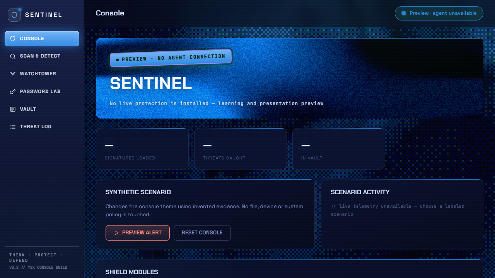

<div align="center">

# SENTINEL

**A glass desktop console. A connected browser companion.**

Explore file inspection, password health and suspicious-link warnings in one Windows school demo.

[**Download v1.0.0**](https://github.com/LoopTryx/Sentinel/releases/tag/v1.0.0) · [Demo guide](docs/today-demo.md) · [Report an issue](https://github.com/LoopTryx/Sentinel/issues)

**Windows · Chrome extension · Local processing · v1.0.0 school demo**

</div>

---



*Earlier console preview showing the visual foundation. v1 adds the glass desktop window, shared dummy accounts and connected runtime; this image is not evidence of live protection.*

## What you can try

| Feature | In v1.0.0 |
|---|---|
| **Glass desktop** | Grouped navigation, custom window controls and an activity feed connected to local session events. |
| **File inspection** | Selected file/folder reads, hashes, cancellation and partial/error results. ClamAV detects the included harmless test signatures. |
| **Password workspace** | Four invented accounts, computed weakness/reuse checks, recommendations and a cryptographic generator. Paired clients share demo account edits. |
| **URL warnings** | Opted-in navigation warnings based on local keyword rules and a sourced domain-list snapshot. Coverage is partial. |
| **WhatsApp warnings** | Opted-in local wording checks and inline explanations for supported rendered WhatsApp Web messages. |

**Scope:** this is a working school demo, not a finished antivirus or credential vault. ClamAV receives only verified harmless sample bytes; other selected files get bounded byte inspection. Demo passwords stay in memory and reset when the runtime stops. Microsoft Defender remains enabled.

## Start the demo

1. Download **Sentinel-v1.0.0-Windows-portable.zip** from the [release page](https://github.com/LoopTryx/Sentinel/releases/tag/v1.0.0) and extract it.
2. On Windows, ensure **PowerShell 7**, **.NET Framework** and the **WebView2 runtime** are available.
3. Open PowerShell 7 in the extracted folder and run:

   ```powershell
   ./Start-Sentinel-Demo.ps1
   ```

4. In Chrome, open `chrome://extensions`, enable Developer mode, choose **Load unpacked**, and select the extracted `apps/extension/dist` folder.
5. Open the desktop **Threat Log** connection controls. Create pairing for the extension's exact ID, then enter the displayed port/key in the extension's connection controls.
6. Enable URL or WhatsApp warnings through the extension controls and approve the relevant Chrome permissions yourself.

The ZIP is portable; there is no installer. See the [five-minute walkthrough and pairing details](docs/today-demo.md) if you get stuck.

### A quick route through Sentinel

- **Passwords:** inspect Orbit Mail's weak password and the reused School Portal/Arcade passwords. Generate a demo replacement and observe the audit change in both paired clients.
- **Scan & Detect:** select `apps/demo-runtime/samples/02-marker.txt`, then the samples folder. Inspect the actual findings, byte counts and hashes.
- **Browser:** enable warnings and use the controlled examples in the demo guide. Review local explanations without submitting private messages or passwords.
- **Threat Log:** inspect the session's recorded actions and reason codes.

## Build from source

Use the [v1.0.0 source archives](https://github.com/LoopTryx/Sentinel/releases/tag/v1.0.0) for the pinned release. `main` contains subsequent work.

From the repository root, with Node.js and the repository's pnpm version available:

```powershell
pnpm install --frozen-lockfile
pnpm --filter @sentinel/ui build
node apps/extension/scripts/build.mjs
./apps/desktop/build-console.ps1 -WebView2SdkPath "C:/path/to/Microsoft.Web.WebView2"
cargo build -p sentinel-av --bin sentinel-inspect
$inspectionTarget = if ($env:CARGO_TARGET_DIR) { $env:CARGO_TARGET_DIR } else { "target" }
./tools/stage-inspection-engine.ps1 -EnginePath (Join-Path $inspectionTarget "debug/sentinel-inspect.exe")
pwsh -NoProfile -File ./tools/launch-demo.ps1
```

The inspection worker must be staged before launching; building only the UI leaves file scans unavailable. The native host needs the official WebView2 SDK. The prepared ClamAV executable, databases and certificate files are included in the portable release; they are not vendored into the source archive. Follow the [demo setup notes](docs/today-demo.md) when preparing a source build.

To run the repository checks on a configured Windows development machine:

```powershell
./tools/verify.ps1
```

## Still being built

Persistent encrypted credential storage, approved imports/autofill, download-to-desktop scanning, automatic desktop logging of navigation warnings, consented cloud explanations and full offline/rehearsal acceptance remain unfinished. Do not enter real credentials into the demo vault.

## Project map

| Location | Purpose |
|---|---|
| [`apps/ui`](apps/ui) | React console and password workspace |
| [`apps/desktop`](apps/desktop) | Glass Windows host used by this demo |
| [`apps/extension`](apps/extension) | Chrome companion and local warnings |
| [`apps/demo-runtime`](apps/demo-runtime) | Shared demo state and bounded inspection |
| [`packages/contracts`](packages/contracts) | Generated contracts between components |
| [`crates`](crates) | Rust runtime and security foundations |

[Release evidence](docs/v1.0.0-demo.md) · [Implementation status](STATUS.md) · [Master plan](docs/Sentinel-Master-Plan.md) · [Collaboration rules](docs/AI-COLLABORATION.md)
