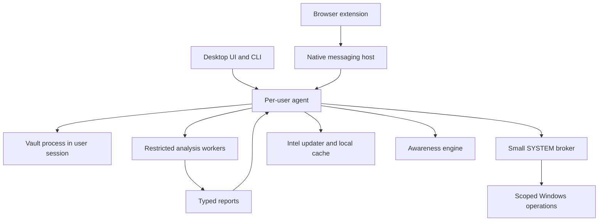

# Sentinel — Improved Requirements and Complete Implementation Plan

Version 2.1 planning proposal · 29 September 2026 · Owner: Loop

**Goal:** Build a local-first Windows security companion that helps its owner inspect files, recognize suspicious networks and devices, protect credentials, and understand security decisions while Microsoft Defender remains active.

**Architecture:** A small privileged Windows broker performs tightly scoped system operations. User-session agents, isolated analysis workers, a desktop UI, and a browser extension provide the product features. Vault keys and plaintext remain outside the system broker.

**Tech stack:** Rust, Tauri 2, React, TypeScript, WXT, SQLite, YARA-X, an optional separate ClamAV process, Windows APIs, and versioned JSON lesson content.

**Spec:** This document is the revised product specification and integrated delivery plan. It supersedes conflicting requirements in the supplied PRD v1.0; the feature mapping below explicitly identifies changed or deferred behavior.

**Intended use:** Personal and educational, confirmed by the owner. Public distribution, commercialization, and public reputation claims are outside the initial release.

**Execution:** Implement one task at a time with the available executing-plans workflow. Read the relevant requirements and task together. Do not interpret this planning document as evidence that any capability has already been implemented or tested.

## 1. Recommendation

Keep the strongest idea: **protection that explains its evidence and limitations**. Make real USB protection a Phase 1 product pillar, not a later extra. Deliver a useful security companion early, but define the first usable alpha around a real USB Gate: new removable storage is held for inspection before normal access where Windows controls prove it possible, and new HID/composite devices require explicit approval before they can act in the supported test matrix.

The original document combines an endpoint security product, a password manager, browser protection, hardware policy management, and a learning platform. Each has different trust boundaries and testing requirements. A single “everything works” release creates too much risk and delays useful feedback.

Use three release checkpoints inside the original functionality phase:

1. **R0 — Evidence and foundations:** prove platform capabilities and recovery; establish secure component boundaries.
2. **R1 — Protected personal alpha:** file scanning and inspection, Wi-Fi observations, USB Quarantine Gate for removable storage, BadUSB HID approval gate for new keyboard-like devices, basic Web Shield, hygiene checks, and eight lessons.
3. **R2 — Expanded personal release:** vault, autofill, mail/chat analysis, monitoring, all 25 lessons, signed updates, and broader hardening.

Then perform **R3 — Aurora Glass presentation and localization**. Accessibility, legible warnings, and safe interactions begin in R0/R1; only decorative work waits for R3.

Alternative approaches considered:

| Approach | Benefit | Tradeoff | Decision |
|---|---|---|---|
| Build every original feature before first use | Preserves original release shape | Long integration cycle; risky dependencies remain hidden | Reject |
| Browser-only educational companion | Fastest useful demo; low system privilege | Loses meaningful USB and Windows integration | Useful fallback, not the main product |
| Incremental Windows companion | Keeps the vision; validates difficult claims before depending on them | Requires explicit release scope and capability labels | Recommended |

## 2. Global constraints

- Personal and educational use; Windows x64 first; working name Sentinel.
- Microsoft Defender stays enabled. Do not register or advertise Sentinel as a replacement antivirus.
- No kernel driver in the initial release. R1 still targets real USB blocking using Windows policy and service controls, but capability labels must distinguish verified pre-access hold, post-mount rapid containment, and unsupported paths.
- No file contents, mail/chat text, passwords, TOTP seeds, or vault records uploaded by the product.
- Network requests use an explicit provider policy. Hash prefixes still disclose limited information; full-hash lookups require separate opt-in.
- No keystroke text collection, real keystroke replay, credential guessing, packet injection, or automatic message sending. HID protection uses device approval, timing/rate metadata, and policy state, not captured characters.
- Unknown, unavailable, disabled, stale, partially checked, and failed are distinct states.
- No elevated file parser, web-content interpreter, or ML model runtime.
- No automatic destructive remediation from a heuristic alone.
- All strings use localization keys; all essential flows support keyboard and screen readers from the first functional UI.
- Every OS mutation has a preview, authorization boundary, operation journal, and tested recovery.
- Tests use benign fixtures and owned laboratory equipment. No real malware is required.
- Unverified platform capabilities stay disabled and visibly labeled unsupported. A build cannot be called R1 unless at least one declared Windows 11 Home/Pro test configuration passes the USB Gate release matrix.

## 3. Corrections to the original PRD

| Original requirement | Improved requirement and reason |
|---|---|
| “Antivirus-grade” protection | “Defensive security companion.” Quality claims require measured evidence beyond EICAR and fixture tests. |
| Windows 10 and 11 as equal defaults | Supported Windows 11 Home/Pro first. Windows 10 is an optional legacy compatibility target, not a promise of OS security. Standard Windows 10 support ended in October 2025. [Microsoft lifecycle](https://support.microsoft.com/en-us/windows/deployment/updates-lifecycle/windows-10-support-has-ended-on-october-14-2025) |
| Installation restrictions guarantee every USB cannot act | Treat policy enforcement as a capability to prove per edition/build and device path. Existing devices, policy precedence, and composite parent/child nodes need separate tests. [Microsoft device policy guide](https://learn.microsoft.com/en-us/windows/client-management/client-tools/manage-device-installation-with-group-policy) |
| VID/PID and serial identify trusted hardware | Treat identifiers as spoofable labels, not authentication. A baseline means “previously approved,” not “verified harmless.” |
| Composite HID/storage is automatically Dangerous | Flag unexpected functionality; legitimate docks, keyboards, and phones can be composite. Hardware descriptors alone do not prove malicious intent. |
| Scan raw FAT/exFAT/NTFS on all editions in v1 | R1 does not require custom filesystem parsers. It uses OS-supported removable-volume access inside a restricted scanner after normal user access is blocked or rapidly revoked. Any exposure window is measured and displayed. |
| Runtime USB Autopsy replays attempted typing | Remove collection of real typed content. R1 blocks or requires approval for new keyboard-like HID devices in the supported matrix, records timing/rate metadata only, and displays "blocked before input" only when verified by hardware tests. |
| Suspend or kill a process on mass rename or fast typing | Notify first. Experimental containment requires strong attribution, protected-process exclusions, explicit opt-in, and recovery. Do not kill process trees from timing correlation. |
| Wi-Fi score identifies evil twins | Show observed risk and coverage. Mesh, roaming, captive portals, VPNs, enterprise TLS, and CDN differences can explain changes. A score is not a probability of safety. |
| Valid publisher signature allows a scan bypass | Signature validity is evidence only. It never overrides a stronger malicious finding or skips mandatory checks. |
| Passwords never enter page context during autofill | Filled values enter the page DOM and may be read by that page. Keep vault keys and unrelated records isolated; release only the selected credential to a validated destination. [Chrome content scripts](https://developer.chrome.com/docs/extensions/develop/concepts/content-scripts) |
| Job object and low integrity create a complete sandbox | Add restricted tokens/AppContainer where feasible, explicit access control, no-network enforcement, handle allowlisting, and escape tests. Job objects primarily provide process/resource management. [Microsoft job objects](https://learn.microsoft.com/en-us/windows/win32/procthread/job-objects) |
| Service ≤80 MB while holding ClamAV | Budget broker and scan engine separately. ClamAV recommends substantially more RAM, around 3–4 GiB for its standard setup. Measure complete process trees. [ClamAV requirements](https://docs.clamav.net/) |
| ClamAV process/dynamic boundary resolves GPL | Process isolation is a security decision, not a licensing conclusion. Record GPLv2 obligations; review redistribution before sharing binaries. [ClamAV](https://www.clamav.net/about) |
| A supplied hash proves an update is authentic | Authenticate the manifest/signature first; then verify payload hashes. A hash downloaded alongside an untrusted payload is insufficient. |
| Phase 2 supplies accessibility | Phase 1 includes accessible semantics, focus, contrast, and warning flows. Phase 2 refines presentation. |

These changes strengthen the scope; they do not silently discard feature areas. Conditional research features have explicit exit criteria below.

## 4. Users, success, and non-goals

Primary user: the owner using a personal Windows laptop and owned lab devices. Secondary user: a learner who wants a concise explanation and a safe next action.

Core journeys:

1. Inspect a suspicious download and see what was checked, what was skipped, why it was flagged, and what to do.
2. Connect to Wi-Fi and understand whether its observed configuration changed or checks could not run.
3. Plug in a device and see its interfaces, approval history, available controls, and any limitations.
4. Save and explicitly fill a credential without revealing other vault items.
5. Read a suspicious message and receive a short, local explanation without uploading its contents.
6. Complete a lesson and gain knowledge without confusing lesson completion with machine protection.

Success measures for the personal release:

- Every warning includes a reason, evidence source, check time, and usable next action.
- No tested recovery scenario leaves Sentinel-owned USB restrictions behind.
- No plaintext secrets or message bodies appear in logs, diagnostic bundles, or permitted network requests.
- Every unavailable capability is visible; no skipped scan produces an unqualified clean result.
- Controlled clean-corpus false positives and message-classifier precision/recall are measured and versioned.
- Scan, unlock, offline, update-failure, and uninstall flows work with Defender enabled.

Out of scope: replacing Defender, defeating an administrator/kernel compromise, firmware attestation, mobile WhatsApp scanning, VPN service, automatic account password changes, cloud sync, remote family management, and a guarantee that sandbox execution proves safety.

## 5. Architecture and trust boundaries



### 5.1 Component responsibilities

| Component | Responsibilities | Must not do |
|---|---|---|
| `sentinel-proto` | Versioned DTOs, errors, capability contracts, generated TS types | OS operations or credentials |
| `sentinel-agent` | Per-user orchestration, event subscriptions, jobs, ordinary reads | Implicit elevation or arbitrary privileged commands |
| `sentinel-svc` | Scoped policy transactions, protected quarantine moves, privileged observations | Parse hostile files, hold vault secrets, fetch arbitrary URLs |
| `sentinel-worker` | Bounded static parsing and scanning from approved handles | Access unrelated files, launch shells, reach the network |
| `sentinel-vault` | KDF, keys, encrypted records, import/export and selected credential release | Send secrets through the SYSTEM broker or logs |
| `sentinel-native-host` | Validate browser connection and relay allowlisted messages | Generic filesystem access or arbitrary RPC forwarding |
| Desktop UI | State presentation, user choices and explanations | Trusted enforcement based on UI state alone |
| Extension | Local page checks, DNR enforcement, gesture-bound fill | Treat page-provided messages as trusted commands |
| `sentinel-intel` | Validated provider data, provenance, expiry and atomic cache activation | Treat every downloaded feed as authenticated truth |

### 5.2 IPC security

Use separate named-pipe endpoints for user operations and administrative operations. Bind authorization to the actual pipe client token/SID and session; request-provided identity is not trusted. Reject remote pipe clients. Per-session nonces are defense in depth, not a replacement for Windows access checks.

Define a method allowlist per caller role. A browser connection can request URL assessment and approved vault operations; it cannot restore quarantine, edit policy, or scan an arbitrary privileged path. Require elevation/admin authorization for machine policy changes. Account for fast user switching and multiple interactive sessions.

Set a 1 MiB application message cap, schema validation, rate limits, cancellation, timeouts, and protocol-version negotiation. Long-running scans return job IDs rather than holding an RPC open. Sensitive requests expire and cannot be replayed. UI capabilities do not grant general system access.

Native host registration uses exact extension IDs. Browser content-script requests are untrusted; the extension checks the actual sender tab/frame and current URL rather than supplied URL fields. Maintain bounded service-worker state that survives suspension.

### 5.3 Data model

Replace the overloaded `Safe` and score-only verdict with:

```typescript
type Assessment = {
  id: string;
  subjectRef: string; // opaque local identifier, not secret content
  risk: 'none_observed' | 'info' | 'suspicious' | 'high' | 'unknown';
  confidence: 'low' | 'medium' | 'high';
  coverage: 'complete' | 'partial' | 'unavailable';
  checks: Array<{
    id: string;
    state: 'pass' | 'finding' | 'skipped' | 'error';
    reasonKey: string;
    evidenceRefs: string[];
  }>;
  reasons: Array<{ code: string; messageKey: string }>;
  actions: Array<{ id: string; requiresAdmin: boolean }>;
  engineVersions: Record<string, string>;
  observedAt: string;
  expiresAt: string | null;
  lessonIds: string[];
};
```

`complete` means all checks in a declared scan profile completed, never that all possible threats were excluded. “No threats found in completed checks” is appropriate; “This device is safe” is not.

Additional entities: `CapabilityStatus`, `ScanJob`, `QuarantineItem`, `DeviceObservation`, `PolicyTransaction`, `NetworkBaseline`, `FeedVersion`, `AwarenessEvent`, `LessonProgress`, and `VaultItemMetadata`. Store secrets in separately encrypted vault records, not general event tables.

Separate **protection coverage**, **system hygiene**, and **learning progress**. Never increase protection status because a quiz was completed. Initial Wi-Fi UI uses categorical states plus a checks summary; a numeric meter is optional after calibration.

### 5.4 Storage and retention

- Machine policy journal and quarantine: ACL-restricted machine storage.
- Per-user settings, activity, Wi-Fi baselines, and learning progress: per-user storage.
- Vault: separate encrypted database per user; encrypt item metadata as well as secrets.
- Activity/log retention: 30 days by default; configurable, with delete/export controls.
- Raw mail/chat content: in-memory processing only; clear on navigation and do not persist.
- USB timing experiment: aggregate intervals only, discarded within 60 seconds; no key codes or reconstructed strings.
- Quarantine persists until explicit restore/delete; warn about disk use rather than silently deleting evidence.
- Sanitize paths, URLs, account names, SSIDs, BSSIDs, and device serials in diagnostics. Use keyed pseudonyms where stable correlation is useful; a plain hash of a predictable value is not anonymization.

## 6. Complete feature specifications

### F1 — File scanner, monitoring, quarantine

Support quick, full, custom, removable-volume, and single-file scans. Pipeline: identify stable file handle → hash → local intelligence → signature/YARA checks → bounded static heuristics → combine evidence. Publisher signatures contribute evidence, never a blanket bypass.

Cache on file identity/content validity plus engine/rule versions. Never reuse a cached clean result across changed content. Scan reports include files visited, checked, skipped, access-denied, engine failures, and scan profile.

Use separate-process ClamAV as an optional full-signature mode. Lightweight mode uses available local checks and clearly states that the full signature engine is inactive. Do not claim equal detection coverage.

Quarantine is a journaled operation: verify source identity → copy to protected encrypted storage → authenticate/verify copy → remove the intended original when safe → commit metadata. Interrupted operations reconcile on restart. Cross-volume operations and Defender removing a file mid-operation must not cause silent data loss. Restore to a validated destination, reject reparse-point races and overwrite by default, and require confirmation for executable destinations. Deletion does not promise forensic erasure on SSDs.

User-mode monitoring watches selected folders with debouncing and bounded queues. Overflow, access denial, and USN discontinuity trigger reconciliation plus a visible gap state. Event arrival does not guarantee interception before execution.

Ransomware advisory correlates canary changes and file-operation patterns. Default action is an urgent warning and recovery guidance. Experimental containment requires reliable process identity, PID-reuse protection, critical-process exclusions, and user opt-in; no generic automatic kill feature.

Persistence audit and per-process connection view are read-only. Inventory findings distinguish unusual from malicious. Hostnames cannot always be reconstructed from connections.

Acceptance: EICAR detected when present and readable; nested archive bounds enforced; engine unavailable produces partial coverage; Defender race handled; quarantine survives forced interruption; restore cannot target an unintended path; watchers recover from overflow; canary lab fixture alerts within 5 seconds p95 on the recorded reference machine.

### F2 — File Inspector

Show SHA-256, optional legacy/fuzzy hashes, detected type, extension mismatch, size, signer verification result, entropy, archive entries, PE metadata, embedded links, macro/script presence, and rule evidence. MD5/SHA-1 are identifiers only, not integrity assurances.

Never render extracted active HTML or execute embedded content. Strings and scripts appear as escaped text. Workers receive minimal read handles and explicit memory/time limits. Initial defaults: 512 MiB worker memory, 30 seconds per item, archive depth 5, at most 10,000 entries and 512 MiB total decompressed output. Limits produce an incomplete result and can be increased explicitly for a chosen job.

Encrypted archives, unsupported filesystems, offline cloud placeholders, and unreadable files are reported as uninspected. No automatic cloud-file hydration. Fuzz parsers separately from the Windows host; run Windows containment tests on actual worker builds.

Acceptance: at least 20 format fixtures, malformed and hostile archive paths, resource exhaustion, timeout, worker crash, and denied network/file access leave the agent alive and report incomplete analysis.

### F3 — Sentinel Dock and USB Gate

Phase 1 includes real-device USB protection in a supported hardware matrix. Treat storage and BadUSB/HID as two related but separate defenses:

1. **Storage Quarantine Gate:** when a new removable storage device appears, block normal user access as early as Windows policy and service timing allow; scan the device through a restricted worker; then release, keep blocked, or eject based on the result and user choice.
2. **BadUSB HID Approval Gate:** when a new keyboard-like, mouse-like, or composite HID interface appears, block or hold it for approval in the supported matrix before it can deliver input. If a device cannot be held before input on a tested configuration, Sentinel must show that gap and the build does not pass the R1 USB Gate for that configuration.
3. **Observe and Explain:** inventory interfaces and device changes; show approved history, descriptor anomalies, policy state, scan actions, exposure windows, and exactly what was blocked.
4. **Research:** raw storage acquisition and sandbox-assisted behavior observation can improve later releases, but R1 protection does not depend on a full VM per USB device.

Inventory groups composite parent/child devices. A new network interface, unexpected keyboard function, or changed identity prompts review, not a universal Dangerous verdict. First-run approval is explicit; do not automatically trust everything attached. Do not exempt entire HID classes to solve lockout risk. Existing keyboard and mouse devices needed for recovery are baseline-approved during setup and shown to the user.

Enforcement prerequisites: record existing policy ownership; detect domain/MDM control; refuse conflicting managed configurations; save exact values and their prior existence; arm an independent recovery helper; verify a trusted input/recovery path; apply a narrow transaction; verify effective policy. A successful registry write does not prove enforcement.

Recovery helper must work without the UI and without the main service remaining healthy. Use a 60-second trial lease for new policy changes; commit only after explicit confirmation and health verification. Restore only Sentinel-owned changes, preserving unrelated administrator changes. Test reboot and power-loss reconciliation. Document an offline recovery path appropriate to the machine, including availability of any disk-unlock material before lab testing.

Storage quarantine flow: detect device arrival; resolve parent/child/interface identity; apply or verify the hold policy; suppress or revoke normal drive exposure; open only broker-approved read handles for scanning; run file inventory, hashes, signature/YARA checks, archive/script/shortcut/macro inspection, and optional ClamAV; produce a report; then release the device, keep it blocked, or eject it. Releasing a device records the assessment version and time. Reconnecting after content, identity, policy, or engine changes triggers a new gate.

HID gate flow: detect new HID or composite HID interface; compare with approved local baseline; block or hold unapproved input-capable interfaces; display vendor/product/serial/path/interface class and spoofing warning; require user approval using an already trusted input path; record the approval with scope and expiry. Suspicious timing metadata can strengthen a warning, but the primary R1 defense is device approval before input, not judging typed content after the fact.

Show “Held” only when effective blocking is verified. Otherwise show “Detected — blocking unavailable” or “Observed after activation.” Separate `device approved`, `input held`, `files scanned`, `normal access blocked`, and `read-only scanner path verified`. Removing a drive letter is not proof of isolation. A scan of storage says nothing conclusive about firmware. A clean storage scan does not approve an attached HID interface.

Test first insertion, previously installed devices, port changes, hub chains, resume, reboot, spoofed identifiers, composite interfaces, docks, and input recovery. Zero observed pre-approval input for unapproved HID devices in the declared R1 matrix is a release gate for BadUSB protection on that matrix, not proof for every USB device. If the matrix fails, the build may still be useful, but it must not be called the protected R1 release requested here.

Raw-storage research must prove acquisition timing and safe release for each supported filesystem. No all-edition pre-mount claim. Initial supported path is ordinary mounted removable-volume scanning with the limitation displayed.

Sandbox research starts with benign executables. Network, clipboard, and unnecessary device redirection are disabled; input is read-only. Report egress is a separate reviewed design: read-only mapped input does not itself return reports. Do not add an arbitrary writable host share as a shortcut. Microsoft documents mapping-related exposure. [Windows Sandbox configuration](https://learn.microsoft.com/en-us/windows/security/application-security/application-isolation/windows-sandbox/windows-sandbox-configure-using-wsb-file)

### F4 — Wi-Fi Guard

Observe security mode, available BSS data, active adapter, gateway, DNS configuration, captive-portal indicators, and changes from user-approved baselines. Report VPN, proxy, Ethernet, multiple adapters, permissions denied, and unavailable APIs explicitly. Wi-Fi APIs can depend on location consent; do not modify privacy settings to bypass it. [Microsoft Wi-Fi permissions](https://learn.microsoft.com/en-us/windows/win32/nativewifi/wi-fi-access-location-changes)

Default checks are passive OS observations. Optional active probes use documented endpoints, strict timeouts, no credentials/cookies, and a connection-specific rate limit. Explain that the provider sees connection metadata. Test controlled DNS answers rather than assuming public CDN answers must match. A different BSSID/OUI/RSSI alone is weak evidence; mesh and roaming fixtures must remain benign.

TLS validation failures prompt a connection warning. A different valid issuer alone does not prove an attack. Avoid pins for unrelated public websites that Sentinel cannot maintain. Certificate failures, portal interception, and deliberate enterprise inspection get different explanations. Cleartext probe changes indicate interception/portal behavior, not a guaranteed attacker identity.

Baselines are trust-on-first-use and user-approved; do not silently replace one after a suspicious change. Keep limited baseline history. Forget/disconnect/DoH/firewall changes require explicit user actions, supported adapters, and reversible configuration. Do not broadly disable sharing or force DoH in response to a low score.

Acceptance: owned-router security downgrade and baseline change produce explanations; mesh roaming and normal CDN answers do not trigger high-risk alerts; denied location and VPN ambiguity yield partial coverage; captive portal is a distinct state; probe failure never marks a connection secure.

### F5 — Vault

Use reviewed cryptographic libraries: Argon2id derives a wrapping key; randomly generated data-encryption key encrypts records with XChaCha20-Poly1305. Encrypt the data key separately for the master password and optional recovery key. Each record uses a unique random nonce; authenticated associated data binds vault ID, item ID, format version, and revision. Version and bound KDF parameters before allocation to resist malicious import files.

Benchmark KDF parameters on the target device with a security floor established during design review. Do not weaken them silently to meet a startup target. Password changes rewrap the data key. Explicit rekeying replaces it when needed. Back up before format migration; interrupted migrations recover without losing the last usable vault.

Start with logins, secure notes, generator, TOTP, encrypted backups, import/export, and audit. Add cards, identities, and bounded attachments after core recovery tests pass. TOTP seeds are secrets; time drift is visible. Similarity/reuse analysis stays local and does not create an unencrypted password index.

Auto-lock after 5 minutes by default and on session lock, sleep, user switch, and relevant remote-session transitions. Clipboard copy is explicit, expires after 20 seconds, and clears only if the clipboard still contains the copied value. Exclude history where supported; do not claim control over every clipboard reader.

Import CSV only through a selected file with format preview, duplicate handling, cancellation, and malicious-value tests. Explain plaintext export exposure before export. Never read browser password databases directly. Recovery kit creation is explicit and never automatically sent to a printer or diagnostics bundle.

HIBP range checks are opt-in, use padding and only the first five hash characters, and do not fire on every keystroke. No full password/hash transmission. [HIBP API](https://haveibeenpwned.com/API/v3#PwnedPasswords)

Windows Hello unlock is a later subtask requiring a precise reviewed platform design; “WebAuthn/DPAPI-NG” is not a sufficient implementation specification. The vault remains usable with the master password.

Acceptance: authenticated round trips, tamper rejection, nonce handling, truncated data, wrong password, resource-capped KDF import, recovery on a fresh user profile, interrupted migration, 10,000-item corpus, auto-lock transitions, and no secrets in logs/IPC outside the vault bridge. Zeroization tests verify owned buffers; do not claim total elimination of OS/browser/memory copies.

### F6 — Web Shield and autofill

Use bounded local URL parsing, IDN normalization, public-suffix-aware domain comparison, local reputation, and DNR rules. Young domains, TLDs, lookalikes, and entropy are supporting signals; none alone establishes maliciousness. Never fetch suspect links to classify them. RDAP is optional because it exposes the queried domain.

Maintain a tested DNR subset with rule provenance and browser-specific capacity checks; not every feed entry can become a rule. Runtime heuristic warnings may occur after navigation. Document that gap separately from pre-navigation DNR blocking. [Chrome DNR API](https://developer.chrome.com/docs/extensions/reference/api/declarativeNetRequest)

Interstitials are bundled offline. Overrides are narrow, short-lived, and clearly explain risk. Download scanning begins only once the native agent can validate the completed file; browser metadata does not grant arbitrary privileged filesystem access. Extension download events cannot guarantee pre-execution prevention.

Autofill requires a current user gesture in extension-owned UI. Bind selection to tab, frame, origin, and navigation state; reject stale requests, HTTP by default, deceptive origins, and cross-origin frames unless separately approved. Matching domains are suggestions, not automatic consent. No automatic form submit. Filled values become readable to the destination page; only the selected item is released.

Tracker blocking is opt-in with per-site exceptions and rule-license tracking. Count only blocking evidence available through permitted APIs; no invented counters. HTTPS upgrades must respect compatibility and visible errors.

Acceptance: local benign test domains exercise block/allow/override without visiting malicious sites; MV3 restart retains durable state; native-host loss shows degraded status; hostile page messages cannot access the vault; changed tab/frame/origin invalidates fill; DNR exhaustion is handled visibly.

### F7/F8 — Mail and Chat Guard

Request site access separately for Gmail, Outlook Web, and WhatsApp Web. Analyze only the currently opened message/chat content necessary for the feature. Do not crawl mailboxes or chat history.

Provider adapters extract a normalized local document with field provenance. Missing headers, unreadable images, unavailable sender details, and selector failure produce partial coverage. Displayed text claiming SPF/DKIM/DMARC success is not authoritative authentication evidence. QR decoding uses already available image data where possible; do not load remote tracking images merely to inspect them.

Rules cover deceptive links, OTP requests, urgency/payment pressure, impersonation, dangerous attachment names, and common scam patterns. Phone country/region is context only and never sufficient to flag fraud. Attachment contents require an actual downloaded file scan.

Ship deterministic rules first. Add an ONNX model only if a held-out, deduplicated, licensed dataset shows improved precision/recall across mail sources and languages. Record confusion matrices and sample sizes; the original 90% recall/3% false-positive goals are evaluation targets, not proven capability. No automatic sending, deleting, blocking contacts, or reporting accounts.

Acceptance: provider fixtures and selector-change fixtures, benign multilingual examples, keyboard-accessible overlays, bounded DOM processing, no message content in network traffic/logs, and visible paused states. Synthetic fixtures do not prove current live-site compatibility; manually test consenting personal accounts before declaring support.

### F9 — Awareness Engine

Data-driven lessons use versioned schemas, localization keys, safe static interactions, and action IDs mapped to trusted app operations. No arbitrary remote HTML or executable lesson code.

Start with eight cards: A01, A04, A05, A06, A08, A10, A16, and A25. Expand to all 25 in R2. Default cap: two unsolicited lessons per day, maximum one per topic per week. Security warnings are not suppressed by lesson caps. Snooze, disable, and voluntary practice remain available.

| ID | Lesson | Trigger/action |
|---|---|---|
| A01 | Password Autopsy | Weak-password check; generate a stronger candidate locally |
| A02 | Reuse Radar | Local reuse finding; open affected entries |
| A03 | Breach Timeline | Optional sourced breach metadata; otherwise labeled fictional example |
| A04 | Phishing Dojo | Message finding or practice; identify red flags |
| A05 | URL X-Ray | Suspicious URL; inspect actual registrable domain |
| A06 | Wi-Fi Checks Explained | Network report; review checks and missing coverage |
| A07 | Open Wi-Fi Explained | Open network; distinguish HTTPS protections and remaining risks |
| A08 | USB Autopsy | Device anomaly; synthetic interface/input illustration only |
| A09 | Charge-Only Cables | Device education; understand data paths and limits |
| A10 | Double-Extension Trap | Type mismatch; identify the actual extension |
| A11 | Download Danger Meter | Download report; review origin/type/scan coverage |
| A12 | 2FA Coach | User-declared account setup; explain methods |
| A13 | Passkeys 101 | Voluntary follow-up; compare sign-in approaches |
| A14 | Email Header Explainer | Available header evidence; show what was not verified |
| A15 | Scam Number Explainer | Scam behavior finding; avoid judging by country alone |
| A16 | OTP Never-Share | OTP request pattern; practice a refusal |
| A17 | Ransomware Drill | Lab/demo or canary alert; review backup recovery |
| A18 | Tracker Footprint | Actual available block counts; explain limited visibility |
| A19 | Extension Permissions | User-invoked audit; inspect permission meaning |
| A20 | Update Nudger | Confident software-version match; open vendor updater |
| A21 | Quishing Guard | Locally decoded QR; inspect destination without opening |
| A22 | Clipboard Hygiene | Explicit vault copy; demonstration, no general clipboard surveillance |
| A23 | Fake Login Lab | Origin mismatch; compare synthetic pages |
| A24 | Social-Engineering Quiz | Opt-in practice; scenario choices |
| A25 | Hygiene Report | Weekly local report; redact before export |

HIBP password presence cannot supply account breach dates. A known-2FA-site list cannot prove the user enabled or lacks 2FA. These lessons must state those limits.

Acceptance: all cards schema-valid and keyboard usable; every trigger has a fixture; every card has an actionable next step; counters are idempotent; no secret appears in a lesson snapshot; mastery changes learning repetition, not protection status.

### F10 — System Hygiene

Read Defender, firewall, encryption, update, and selected security settings through supported APIs where available. Distinguish installed product inventory from actual protection health. Support unknown states rather than inferring healthy from absent data.

Review startup persistence, listening ports, browser hardening guidance, SMBv1, RDP configuration, and UAC. A local listening RDP port does not establish Internet exposure. Installed-app vulnerability matching needs product/version confidence; KEV is not a complete inventory map and OSV does not cover all Windows applications.

Fix actions initially open trusted Windows/vendor settings. Any later configuration change goes through an explicit broker transaction. No broad unattended hardening.

### F11/F12 — Intel, settings, privacy, updates

Provider registry records purpose, license, auth requirements, exact data sent, refresh interval, quota, expiry, parsing limits, and failure behavior. Enable only verified integrations. Do not assume every original feed remains freely accessible or redistributable. Safe Browsing is limited to non-commercial use; personal use fits the intended category subject to its terms, but integration/API choice still needs verification. [Google Safe Browsing](https://developers.google.com/safe-browsing)

Default online mode: explicit opt-in to selected feed downloads and update checks. Password-prefix lookups, domain queries, and full-hash reputation each have separate consent. No telemetry backend in the personal release. Offline mode does not generate background lookups.

Use HTTPS, bounded downloads, strict parsers, backoff, atomic activation, and last-known-good caches. Where upstream signatures do not exist, disclose transport-based authenticity rather than inventing signature validation. Bloom-filter positives require exact confirmation.

Updates verify a trusted signed manifest, version/expiry/channel/platform constraints, and artifact hash/signature before elevated installation. Test key rotation, revoked keys, downgrade attempts, interrupted install, and database compatibility. Rollback uses a compatible known-good build without accepting arbitrary old signed versions.

Keep local unsigned developer builds separate from the signed update channel. App-update trust keys are distinct from Windows executable-signing certificates. Never embed signing private keys in the app/repository. Public distribution would add a separate signing, licensing, and store-review gate.

Settings cover capabilities, modes, exclusions, provider consent, retention, backup, language, motion, diagnostics, and recovery. Exclusions are narrowly scoped, auditable, and never silently suppress unknown engine failures.

## 7. Repository and interface plan

The workspace was empty apart from Git metadata when inspected. Paths below are planned new files, not existing implementations.

```text
crates/
  sentinel-proto/src/{assessment,capability,rpc,jobs}.rs
  sentinel-core/src/{config,error,privacy,paths}.rs
  sentinel-agent/src/{main,dispatch,jobs,events}.rs
  sentinel-svc/src/{main,auth,policy,quarantine}.rs
  sentinel-recovery/src/{main,journal,rollback}.rs
  sentinel-worker/src/{main,isolation,limits}.rs
  sentinel-intel/src/{providers,download,cache,lookup}.rs
  sentinel-scan/src/{pipeline,cache,quarantine,watcher,ransomware}.rs
  sentinel-inspect/src/{formats,archives,report}.rs
  sentinel-usb/src/{inventory,policy,capability,recovery}.rs
  sentinel-wifi/src/{observe,checks,baseline,report}.rs
  sentinel-vault/src/{format,crypto,store,recovery,import,autofill}.rs
  sentinel-hygiene/src/{checks,inventory,report}.rs
  sentinel-awareness/src/{catalog,triggers,limits,progress}.rs
  sentinel-native-host/src/{main,validation,relay}.rs
  sentinel-cli/src/{main,commands}.rs
apps/ui/src/{features,components,i18n,styles}/
apps/extension/{entrypoints,lib,adapters,locales}/
packages/contracts/                  # generated TypeScript
data/{awareness,rules,fixtures}/
tests/{integration,security,hardware,fixtures}/
tools/{verify.ps1,demo.ps1,benchmark.ps1}
docs/{adrs,threat-model,demos,evidence,support}/
```

Public contract operations, defined first in `sentinel-proto`:

| Operation | Request → response | Authority |
|---|---|---|
| `capabilities.list` | empty → capability list | User |
| `scan.start` | approved subject reference + profile → job ID | Agent validates subject access |
| `jobs.get` / `jobs.cancel` | job ID → status/acknowledgment | Job owner |
| `assessment.get` | assessment ID → Assessment | Subject owner |
| `usb.list` | empty → device observations | User, redacted |
| `usb.policy.preview` | selected operation → transaction preview | Admin boundary |
| `usb.policy.apply` / `revert` | authorized transaction ID → result | Elevated broker |
| `wifi.assess` | adapter reference + probe consent → job ID | User |
| `quarantine.restore` | item ID + validated destination → job ID | Authorized owner/admin |
| `vault.unlock` | local secure prompt flow → expiring session | Vault process only |
| `vault.fill` | item ID + bound origin/tab/frame/gesture → one-item release | Validated vault bridge |
| `awareness.next` | context reference → optional lesson | User |
| `settings.update` | typed settings diff → effective settings | User or admin by field |

No generic `execute`, shell, registry-write, arbitrary URL fetch, or privileged arbitrary-file-read endpoint. Define typed request/response structures and error codes before module implementations. UI, CLI, and extension use the same contracts where their authority permits; CLI does not bypass user-presence requirements for secrets.

## 8. Implementation tasks and dependencies

Each task is an independently reviewable deliverable. The test cases below are required observable outcomes, not placeholder “add tests” instructions. Write focused failing tests before production logic, implement, run the named checks, record evidence, and commit a buildable result when executing. Detailed implementation code is deliberately not fabricated before the feasibility work establishes which Windows APIs and policies are valid.

### T00 — Capability and threat-model dossier

**Files:** `docs/adrs/0001-platform.md`, `docs/threat-model/boundaries.md`, `docs/evidence/capability-matrix.md`, `docs/adrs/0002-dependencies.md`.

**Depends on:** none. **Produces:** supported configuration table and go/no-go decisions.

- [ ] Record Windows edition/build, hardware, administrator access, Defender state, and available VM/lab equipment.
- [ ] Document assets and attackers: hostile file, page, device, feed, same-user process, and compromised update source; explicitly exclude a fully compromised OS.
- [ ] Probe device enumeration/policy precedence, Wi-Fi consent behavior, restricted worker isolation, ClamAV memory, and native-host launch in disposable environments.
- [ ] Record provider and dependency license/auth requirements; pin a working toolchain, not invented future version numbers.
- [ ] Classify each capability as proven, partial, unavailable, or untested; hardware evidence cannot be replaced by VM fixtures.

**Gate:** report lists exact observations and fallback decisions. No USB enforcement on the owner's daily-use machine during discovery.

### T01 — Contracts, jobs, and functional shell

**Files:** root `Cargo.toml`, `rust-toolchain.toml`, `package.json`, `pnpm-workspace.yaml`, lockfiles, `crates/sentinel-proto/src/{assessment,capability,rpc,jobs}.rs`, `crates/sentinel-core/src/{config,error,privacy}.rs`, `crates/sentinel-agent/src/{main,jobs}.rs`, `crates/sentinel-cli/src/main.rs`, `apps/ui/src/features/status/`, `.github/workflows/ci.yml`, `tools/verify.ps1`.

**Consumes:** T00 scope. **Produces:** versioned contracts, cancellable job lifecycle, status UI/CLI.

- [ ] Test assessment serialization, invalid enum rejection, protocol mismatch, monotonic job transitions, and cancellation.
- [ ] Generate TS contracts from Rust and fail CI on generated-code drift.
- [ ] Implement a status screen showing enabled, unavailable, and unknown capabilities; add localized accessible controls.
- [ ] Wire CI formatting, lint, Rust/TS tests, and dependency checks. Freeze runnable commands in `tools/verify.ps1`.

**Gate:** a fixture job travels through CLI and UI with identical results; no fabricated “Protected” default.

### T02 — Privilege boundary, installation, and recovery skeleton

**Files:** `crates/sentinel-svc/src/{main,auth,policy}.rs`, `crates/sentinel-recovery/src/{main,journal,rollback}.rs`, `tests/security/ipc.rs`, `tests/integration/recovery.rs`, `packaging/`, `docs/support/recovery.md`.

**Consumes:** T01 RPC/error contracts. **Produces:** authenticated broker and recoverable mutation framework.

- [ ] Test unauthorized SID/session, remote clients, malformed/oversized messages, replay, rate limits, and user attempts at admin methods.
- [ ] Implement minimal Windows service installation and separate user/admin endpoints.
- [ ] Implement durable write-ahead policy journals and independent lease recovery using harmless test state first.
- [ ] Test agent/service crashes, expiry, reboot, interrupted install, and uninstall; restore only owned changes.

**Gate:** recovery works with the UI closed and primary service stopped. No real deny policy until this passes.

### T03 — Intel cache and provider controls

**Files:** `crates/sentinel-intel/src/{providers,download,cache,lookup}.rs`, `tests/integration/intel.rs`, `data/fixtures/feeds/`, `apps/ui/src/features/providers/`.

**Consumes:** typed configuration and jobs. **Produces:** local lookup API with provenance and expiry.

- [ ] Test corrupt/oversized feeds, invalid signatures where supported, duplicate records, stale caches, interrupted replacement, and offline startup.
- [ ] Implement one permitted provider end to end before adding adapters for the approved registry.
- [ ] Add exact lookup confirmation after Bloom filtering, bounded retries, and provider consent UI.
- [ ] Capture outbound mock requests and assert allowed fields only.

**Gate:** offline cached lookup is correct; revoked/invalid data never replaces last-known-good data; p95 lookup target below 10 ms for the recorded fixture size.

### T04 — Restricted worker and scanner

**Files:** `crates/sentinel-worker/src/{main,isolation,limits}.rs`, `crates/sentinel-scan/src/{pipeline,cache}.rs`, `tests/security/worker.rs`, `tests/integration/scan.rs`, `data/fixtures/scans/`.

**Consumes:** T01 jobs, T03 lookup. **Produces:** `scan.start` jobs and Assessments.

- [ ] Test timeout, memory limit, forbidden file/network access, crash recovery, and bounded output with benign worker probes.
- [ ] Integrate YARA-X and optional separate ClamAV, with truthful unavailable-engine results.
- [ ] Add EICAR/archive fixtures, signer-with-detection fixture, cache invalidation, access-denied and Defender race tests.
- [ ] Add quick/custom/full profiles, cancellation, progress, exclusions, and partial-result summaries.

**Gate:** host survives all worker failures and never reports a skipped item as inspected.

### T05 — Inspector and transactional quarantine

**Files:** `crates/sentinel-inspect/src/{formats,archives,report}.rs`, `crates/sentinel-scan/src/quarantine.rs`, `crates/sentinel-svc/src/quarantine.rs`, `tests/security/quarantine.rs`, `tests/integration/inspector.rs`, `apps/ui/src/features/{scan,inspector,quarantine}/`.

**Consumes:** T02 broker, T04 workers. **Produces:** deep reports and restore/delete flows.

- [ ] Test malformed formats, archive traversal/depth/size limits, escaped extracted strings, and unsupported content.
- [ ] Test quarantine at each interruption boundary, cross-volume behavior, ciphertext tampering, changed source identity, and restore reparse/overwrite attacks.
- [ ] Implement inspect and quarantine flows plus narrowly validated shell integration.
- [ ] Add parser fuzz targets and readable report export without private source paths by default.

**Gate:** no lost original before verified quarantine copy; worker failures leave a usable report.

### T06 — Wi-Fi Guard

**Files:** `crates/sentinel-wifi/src/{observe,checks,baseline,report}.rs`, `tests/integration/wifi.rs`, `tests/hardware/wifi-matrix.md`, `apps/ui/src/features/wifi/`.

**Consumes:** T01 assessments; optional T03 provider settings. **Produces:** `wifi.assess` and approved baselines.

- [ ] Test mesh roaming, changed security, portal interception, VPN, multiple adapters, permission denial, DNS variance, and unavailable probes from recorded fixtures.
- [ ] Implement observation collection and opt-in active checks with bounded timeouts.
- [ ] Add baseline approval/history and explicit supported network actions.
- [ ] Run owned-router/manual tests and record build/adapter evidence.

**Gate:** benign topology changes do not become categorical attack claims; every missing check is visible.

### T07 — Phase 1 USB Quarantine Gate and BadUSB protection

**Files:** `crates/sentinel-usb/src/{inventory,capability,policy,recovery,storage_gate,hid_gate,release}.rs`, `tests/integration/usb.rs`, `tests/hardware/usb-r1-matrix.md`, `tests/hardware/badusb-hid.md`, `apps/ui/src/features/usb/`, `docs/demos/usb-gate-r1.md`.

**Consumes:** T02 recovery and T04/T05 scans. **Produces:** real R1 USB protection for supported configurations: storage quarantine before normal access where verified, HID approval before new input, explicit approval history, and rollback.

- [ ] Test composite grouping, missing/spoofed identifiers, removal during scan, already-installed devices, and unsupported policy states.
- [ ] Implement the storage gate: device arrival detection, policy hold/revoke, normal-access state detection, restricted scanner handoff, release/keep-blocked/eject actions, and journaled rollback.
- [ ] Implement the HID gate: baseline trusted input devices, hold unapproved keyboard-like/mouse-like/composite HID interfaces, approve through an existing trusted input path, scope approvals by device path/interface, and expire temporary approvals.
- [ ] Add the USB dashboard states `Held`, `Scanning`, `Clean - ready to release`, `Suspicious - keep blocked`, `Released`, `Blocked - unsupported path`, and `Protection gap observed`.
- [ ] Run the R1 hardware matrix on spare recoverable equipment: Windows 11 Home and Pro when available; clean flash drive; EICAR-on-USB; script/shortcut/macro fixtures; unknown keyboard; programmable HID fixture; composite storage+HID; hub insertion; reboot/resume; previously installed device; spoofed serial; removal during scan.
- [ ] Verify zero unapproved HID input reaches Windows in the declared passing matrix, exact recovery after crash/reboot/power loss, no Sentinel-owned policy left behind after uninstall, and no normal storage access before release on configurations marked `pre-access held`.

**Gate:** R1 USB Gate passes only for configurations with evidence. The UI may say `Full BadUSB protection active` only when storage and HID gates both pass on the current configuration. Otherwise it must show the precise unsupported gap and cannot claim Phase 1 full protection for that machine.

### T08 — Native bridge and Web Shield

**Files:** `crates/sentinel-native-host/src/{main,validation,relay}.rs`, `apps/extension/entrypoints/`, `apps/extension/lib/{protocol,url,dnr,downloads}.ts`, `tests/security/extension.spec.ts`, `tests/integration/web-shield.spec.ts`.

**Consumes:** T01 protocol, T03 intel, T04 scans. **Produces:** browser protection and selected safe agent calls.

- [ ] Test disallowed extension IDs/methods, forged content messages, bad native framing, oversized messages, and absent host.
- [ ] Implement local URL verdicts, DNR rule installation, offline interstitials, and expiring narrow exceptions.
- [ ] Implement completed-download handoff with broker-side access validation.
- [ ] Test service-worker suspension, rule limits, browser restart, and optional host permissions.

**Gate:** known fixture rules block consistently; untrusted pages cannot invoke privileged operations.

### T09 — Awareness foundation and hygiene / R1 release

**Files:** `crates/sentinel-awareness/src/{catalog,triggers,limits,progress}.rs`, `crates/sentinel-hygiene/src/{checks,inventory,report}.rs`, `data/awareness/A*.json`, `apps/ui/src/features/{academy,hygiene}/`, `docs/demos/R1.md`.

**Consumes:** T04–T08 assessments/events. **Produces:** eight initial lessons and honest system overview, including USB Gate explanations.

- [ ] Test lesson schema validation, duplicate-event handling, caps/snooze, absent evidence, and action allowlisting.
- [ ] Implement eight initial cards with synthetic examples and accessible interactions.
- [ ] Implement read-only hygiene checks and unknown-state fixtures.
- [ ] Run the R1 end-to-end demo: inspect file, view network, quarantine and release a clean USB, keep a suspicious USB blocked, block an unapproved HID fixture, block fixture URL, open a lesson, recover offline, uninstall.

**Gate:** R1 release checklist in section 10 passes; report skipped capabilities explicitly.

### T10 — Vault format, backup, and recovery

**Files:** `crates/sentinel-vault/src/{format,crypto,store,recovery}.rs`, `tests/security/vault.rs`, `tests/integration/vault-recovery.rs`, `docs/threat-model/vault.md`.

**Consumes:** per-user lifecycle and contracts; independent of SYSTEM storage. **Produces:** reviewed encrypted vault with recovery.

- [ ] Define and review serialized envelope, nonce/AAD rules, KDF limits, and encrypted metadata before coding storage.
- [ ] Test authenticated encryption round trips, swapped records, altered headers, wrong keys, hostile KDF parameters, and truncation.
- [ ] Implement master/recovery wrappers, atomic writes, encrypted backups, and interrupted migration recovery.
- [ ] Restore a backup under a fresh profile and verify 10,000 records.

**Gate:** use synthetic credentials until cryptographic design review and restore tests pass.

### T11 — Vault UX, import, audit, and autofill

**Files:** `crates/sentinel-vault/src/{import,autofill}.rs`, `apps/ui/src/features/vault/`, `apps/extension/lib/autofill.ts`, `tests/security/autofill.spec.ts`, `tests/integration/vault-ux.spec.ts`.

**Consumes:** T08 bridge, T10 storage. **Produces:** personal password-manager workflows.

- [ ] Add login/note CRUD, secure generator, TOTP, lock transitions, selected CSV imports, and encrypted export.
- [ ] Test clipboard conditional clearing and import cancellation/duplicates/malicious values.
- [ ] Add local strength/reuse checks and opt-in HIBP-prefix requests; assertions reject secrets in logs/network.
- [ ] Test gesture expiry, changed origin/frame/tab, hidden fields, malicious message forwarding, and one-item-only fill.
- [ ] Add cards/identities/attachments with explicit bounds; defer Hello until its separate review passes.

**Gate:** no fill without matching destination and fresh user intent; recovery remains usable after password change.

### T12 — Mail and Chat Guard

**Files:** `apps/extension/adapters/{gmail,outlook,whatsapp}/`, `apps/extension/lib/{message-analysis,qr}.ts`, `data/rules/scams/`, `tests/fixtures/messages/`, `tests/integration/message-guards.spec.ts`.

**Consumes:** T08 URL checks, T09 awareness. **Produces:** opt-in local banners for supported sites.

- [ ] Build provider extraction fixtures with field provenance and missing-field behavior.
- [ ] Test each scam pattern alongside benign multilingual cases and selector failures.
- [ ] Add bounded DOM observers, accessible overlays, QR handling, and per-site permissions.
- [ ] Measure a held-out labeled corpus; add ML only when it improves recorded results without breaking privacy/resource budgets.

**Gate:** no content upload; missing selectors pause analysis visibly; manual consenting-account smoke tests pass for each claimed site.

### T13 — Monitoring, persistence, and ransomware advisory

**Files:** `crates/sentinel-scan/src/{watcher,ransomware}.rs`, `crates/sentinel-hygiene/src/inventory.rs`, `tests/integration/monitoring.rs`, `apps/ui/src/features/activity/`.

**Consumes:** T04 scanner, T09 warnings. **Produces:** bounded background observations.

- [ ] Test duplicate/coalesced events, dropped events, journal gaps, sleep/resume, and queue pressure.
- [ ] Add watcher reconciliation, supported process observations, startup inventory, and connection views.
- [ ] Correlate benign canary changes and mass rename fixtures; default to advisory action.
- [ ] Test critical-process exclusions and attribution failure before any experimental opt-in containment.

**Gate:** no process termination based solely on a heuristic; coverage gaps and resource pressure are visible.

### T14 — Full awareness catalog and settings

**Files:** remaining `data/awareness/A*.json`, `apps/ui/src/features/{academy,settings,reports}/`, `tests/integration/awareness.spec.ts`, `docs/support/privacy.md`.

**Consumes:** all available assessment types. **Produces:** all 25 cards, separate progress/hygiene views, full settings.

- [ ] Complete every catalog row including unavailable-trigger/manual-practice paths.
- [ ] Test privacy redaction in report export and lesson screenshots.
- [ ] Add retention/deletion/provider/exclusion controls and complete offline/error states.
- [ ] Confirm every feature emits appropriate non-secret awareness events without manufacturing detections.

**Gate:** 25 cards render and have meaningful next actions; learning points cannot change protection coverage.

### T15 — Updates, packaging, hardening / R2 release

**Files:** `crates/sentinel-core/src/update.rs`, `packaging/`, `tests/security/updates.rs`, `tests/integration/lifecycle.rs`, `docs/support/{install,uninstall,backup,recovery}.md`, `docs/demos/R2.md`.

**Consumes:** T01–T14. **Produces:** installable expanded personal release.

- [ ] Test corrupted payloads, invalid/expired signatures, rollback attempts, key rotation, interrupted installs, and migration compatibility.
- [ ] Validate MSI/NSIS choice with service/native-host registration and exact owned-state cleanup.
- [ ] Generate dependency/license inventory and SBOM; review vulnerabilities and justify exceptions.
- [ ] Execute full lifecycle with Defender on, standard/admin users, multi-user sessions, disk-full and offline conditions.
- [ ] Complete independent security review of privileged IPC, worker containment, vault/autofill, quarantine, and updates before storing valuable credentials.

**Gate:** R2 checklist passes. Independent review is a real resourcing item; if unavailable, label the build experimental rather than treating self-review as equivalent.

### T16 — Conditional advanced USB and sandbox research

**Files:** `crates/sentinel-usb/src/{raw_storage,timing,sandbox}.rs`, `tests/hardware/advanced-usb.md`, `docs/adrs/usb-research.md`.

**Consumes:** T07 evidence, T05 parsers, T15 hardening. **Produces:** either validated opt-in capabilities or a documented no-go.

- [ ] Expand enforcement tests across supported hardware and previously installed/spoofed/composite paths.
- [ ] Prototype raw acquisition per filesystem; test the kernel/filesystem exposure window and actual read-only enforcement.
- [ ] Evaluate timing-only signals against ordinary typists, accessibility tools, macro keyboards, and paste workflows; collect no key content.
- [ ] Design and review sandbox report egress before introducing any executable behavior observation; use benign samples only.
- [ ] Publish a support matrix and stop unsupported subprojects without weakening release claims.

**Gate:** no universal “BadUSB prevented” claim; zero-lockout recovery suite passes before any personal-machine trial.

### T17 — Aurora Glass and localization / R3 release

**Files:** `apps/ui/src/{styles,components,features}/`, `apps/extension/entrypoints/`, `apps/ui/src/i18n/`, `design/tokens/`, `tests/visual/`, `docs/demos/R3.md`.

**Consumes:** stable R2 contracts. **Produces:** polished UI without changing protection semantics.

- [ ] Build dark/light/high-contrast tokens, opaque text surfaces, focus states, and reduced-motion/transparency variants.
- [ ] Implement dashboard, scan/inspector/quarantine, USB, Wi-Fi, vault, Academy, tray, settings, onboarding, and extension presentation.
- [ ] Use stage animations only for real reported stages; never animate an unavailable sandbox as though it ran.
- [ ] Add Arabic RTL, Hindi, Malayalam, pseudo-locales, and language review for security wording.
- [ ] Verify keyboard/NVDA flows, zoom/reflow, visual regressions, and hidden-window animation suspension.

**Gate:** R3 checklist passes; backend behavior changes receive new requirements/tests instead of being hidden as styling.

### Dependency summary

```text
T00 → T01 → T02
T01 → T03 → T04 → T05
T01 → T06
T02 + T04 + T05 → T07
T03 + T04 → T08
T04..T08 → T09 → R1
T01 → T10; T08 + T10 → T11
T08 + T09 → T12
T04 + T09 → T13
T09 + T11 + T12 + T13 → T14
T01..T14 → T15 → R2
T07 + T15 → T16 (conditional advanced USB research)
R2 → T17 → R3
```

The Windows broker and worker isolation are prerequisites for hostile-input handling. Recovery precedes policy enforcement. Scanner and inspector precede USB file inspection. USB Gate precedes the protected R1 release. Vault recovery precedes autofill.

## 9. Performance and evaluation plan

Use a recorded Windows 11 reference laptop with at least 16 GiB RAM, SSD, four CPU cores, Defender on, and exact OS/engine/feed versions. Measure cold and warm runs separately. These are proposed engineering targets, not present measurements.

| Area | Proposed target / measurement |
|---|---|
| Broker | ≤80 MiB private working set at idle, excluding other processes; separately report complete product total |
| Agent | ≤120 MiB idle before heavy workers; investigate sustained growth across an 8-hour run |
| UI | ≤250 MiB idle including WebView subprocesses; interactive within 3 seconds p95 |
| Idle CPU | Product process-tree average below 1% over 10 minutes after settling; updates/scans reported separately |
| ClamAV | Dedicated measured budget; plan for GiB-scale engine memory, lazy startup, visible engine state |
| Scan throughput | Report files/s, bytes/s, p50/p95 latency, corpus mix, cache state, rule version and peak RAM; retire the unqualified 100k files/60s claim |
| Local intel | p95 <10 ms on declared dataset after cache load |
| UI responsiveness | Progress/event batching; no blocking UI-thread file scans |
| Extension | <1 MiB compressed executable bundle excluding separately disclosed model/rules; measure page CPU separately |
| Archive parsing | Default hard bounds from F2; termination never hangs the parent |
| Background effects | Stop when hidden; reduced-motion mode removes ambient effects |

ML and heuristic evaluation must separate training, tuning, and final holdout by source/time where possible, remove duplicates, report denominators and confidence intervals, and include benign multilingual examples. Fixture accuracy is not real-world detection coverage. Use synthetic reserved domains for browser tests and owned networks/devices for hardware tests.

## 10. Release gates and verification

### Per-task definition of done

- [ ] Requirement and failure-state tests pass.
- [ ] Applicable security/privacy negative tests pass.
- [ ] UI/CLI report the same effective capability and assessment.
- [ ] Strings are localized and controls keyboard usable.
- [ ] Evidence is recorded with commit, OS/build, device/adapter, fixture/feed versions, commands, actual results, and limitations.
- [ ] Demo instructions exist in `docs/demos/Txx.md` and progress is updated in `STATUS.md` during execution.
- [ ] No TODO stubs or simulated results are presented as working protection.

Planned root verification commands, established by T01:

```powershell
cargo fmt --all -- --check
cargo clippy --workspace --all-targets -- -D warnings
cargo test --workspace
pnpm -r typecheck
pnpm -r test
pnpm exec playwright test
```

Windows hardware tests are a separate manual/lab suite; they do not become green because CI fixtures pass. Parser fuzzing can use supported toolchain runners, followed by Windows regression/containment tests. Begin with per-PR fuzz smoke and nightly time-bounded jobs; retain every crash as a regression fixture.

### R1 gate

Scanner/inspector/quarantine, Wi-Fi, USB Quarantine Gate, BadUSB HID approval gate, basic Web Shield, hygiene, and eight lessons pass their tests. Fresh install, offline use, worker failure, service loss, recovery, and uninstall work. On at least one declared Windows 11 test configuration, a clean USB can be held, scanned, and released; a suspicious USB can remain blocked; and an unapproved HID fixture cannot deliver input before approval. No “all protected” status appears when a component is absent or a policy path is unsupported. Core keyboard/screen-reader flows pass.

### R2 gate

R1 plus vault recovery/autofill, mail/chat adapters, monitoring, all 25 lessons, settings, signed-update validation, and privacy negative tests pass. Security review findings that permit secret exposure, privilege escalation, unsafe restore, or lockout are resolved. Windows 11 Home and Pro matrices record supported and unsupported features individually. Do not require Sandbox on Home to declare an honest release.

### R3 gate

All R2 tests remain green. No serious/critical automated accessibility findings; manual NVDA/keyboard completion of onboarding, scanning, device review, network review, vault recovery/unlock/fill, and lessons. Verify 200% text scaling and suitable 400% reflow, high contrast, reduced motion, and RTL. Visual approval and a11y scores supplement functional testing; neither proves usability alone.

### Regression matrix

Test standard/admin users; Defender on; Wi-Fi location denied/allowed; Ethernet/VPN/portal; network offline; stale feeds; service missing/restarting; app crash; worker crash; disk full; changed clock; sleep/resume; RDP/user switch; two users; locked vault; corrupt backup; interrupted upgrade; uninstall after policy experiment. Test USB on physical hardware because VM passthrough changes enumeration behavior.

## 11. Delivery effort and resources

These are rough planning ranges, not promised dates. Assumption: one experienced developer using AI assistance, regular focused work, and access to Windows hardware. They include implementation and verification but exclude waiting for external reviews.

| Checkpoint | Incremental effort estimate | Output |
|---|---|---|
| R0 / T00–T02 | 3–5 developer-weeks | Feasibility findings, contracts, secure broker/recovery |
| R1 / T03–T09 | 12–18 developer-weeks | Protected personal alpha with USB Quarantine Gate and BadUSB HID approval on the declared matrix |
| R2 / T10–T15 | 12–20 developer-weeks | Vault, message guards, monitoring, full lessons, hardening |
| R3 / T17 | 5–8 developer-weeks | Polished accessible multilingual UI |
| T16 research | 4–10+ additional developer-weeks, outcome uncertain | Raw acquisition, broader hardware coverage, and sandbox-assisted USB experiments |

Core total: approximately 32–51 developer-weeks because real Phase 1 USB protection adds hardware testing, recovery engineering, and policy validation. A beginner or part-time schedule can take materially longer. Re-estimate after R0 and after the R1 alpha; do not compress hardware and vault review into a demo deadline.

Resources: Windows 11 Home and Pro test environments; owned spare keyboard/mouse/storage/hub/composite device; a benign programmable HID lab device; a second owned router/hotspot; recoverable spare hardware for policy tests; backup storage; licensed test software as needed; and access to an independent security reviewer for the vault and privileged components.

Personal-use defaults avoid a backend bill. Optional paid APIs are disabled. Unsigned development binaries are acceptable for local lab use; warnings are not silently bypassed. Public distribution would need separate decisions about executable signing, provider terms, licensing, extension stores, trademark, support, and vulnerability reporting.

## 12. Main risks and stop conditions

| Risk | Mitigation | Stop/ship decision |
|---|---|---|
| USB locks out input | Independent lease recovery, narrow policies, spare lab machine, trusted recovery device baseline | Block R1 protected release until recovery passes |
| USB activates before policy takes effect | Measure actual input/driver behavior and existing-device cases | Mark configuration unsupported for R1 BadUSB protection until fixed |
| USB storage becomes readable before scan | Early hold policy, rapid revoke, measured exposure window, clear UI state | Mark as post-mount containment only; no pre-access claim |
| Malicious file exploits parser | Restricted worker, bounded handles, fuzzing, no network | Disable affected parser until fixed |
| Quarantine removes wrong data | Stable identity, reparse checks, atomic journal | Block remediation release on data-loss defect |
| Vault/autofill exposes secrets | Isolated process, encrypted metadata, bound gestures/origins, review | Synthetic credentials only until gate passes |
| Network signals cause false accusations | Benign mesh/VPN/portal fixtures, evidence weighting | Reduce to advisory on ambiguous evidence |
| Feed/model poisoning | Provenance, bounded parsing, authenticated updates, evaluation | Keep last-known-good data; show stale state |
| DOM provider changes | Adapter isolation, fixtures plus live smoke test | Pause affected guard visibly |
| Memory/CPU overhead | Separate engine budget, bounded queues, lazy loading | Offer explicit lower-coverage mode, never hide it |
| Scope overwhelms delivery | R1/R2 boundaries; make USB Gate the main R1 differentiator and defer vault/mail breadth if needed | Preserve real USB protection before expanding |

## 13. Original PRD traceability

| Original area | Plan coverage | Change |
|---|---|---|
| F1 AV / real-time / quarantine / persistence / connections | T04, T05, T13 | Companion scope; user-mode gaps; advisory containment |
| F2 Inspector | T04, T05 | Stronger worker boundary and partial-result handling |
| F3 Sentinel Dock | T02, T07, T16 | Phase 1 USB Gate required for supported matrix; no keystroke recording |
| F4 Wi-Fi | T06 | Evidence/coverage first; benign topology tests |
| F5 Vault | T10, T11 | Recovery and encrypted metadata first; Hello separately gated |
| F6 Web Shield, trackers, downloads, autofill | T08, T11 | Accurate browser limits and origin binding |
| F7 Mail Guard | T12 | Rules first; model earned by evaluation |
| F8 Chat Guard | T12 | Region alone not a fraud signal; read-only |
| F9 Awareness | T09, T14 | All 25 retained; unsupported triggers use labeled practice |
| F10 Hygiene | T09, T13 | Read-only guidance; inventory matching confidence |
| F11 Intel | T03 | Provider permissions/provenance/freshness |
| F12 Settings, privacy, updates | T02, T14, T15 | Lifecycle and recovery designed early |
| Phase 1 UI | T01 onward | Functional and accessible from the start |
| Phase 2 UI and languages | T17 | Aurora Glass retained without fake stages |
| Firefox | Post-R2 compatibility project | Chrome/Edge first; Brave tested before claiming parity |
| Minifilter, cloud sync, mobile, passkeys, enterprise | Backlog | Separate future requirements and reviews |

Original milestone dependency defects are resolved: scanner precedes USB file scanning; recovery precedes policy changes; the user-session vault is explicit; update and installer behavior are designed before final packaging; awareness ships early enough to support the product's differentiator.

## 14. Decisions and first execution step

Confirmed: personal/educational use; retain the full product vision and improve the plan.

Proposed defaults: Rust engine; supported Windows 11 first; Chrome/Edge first; Phase 1 USB Gate as a core deliverable; optional separate ClamAV; rules before ML; no cloud or telemetry; unsigned local builds; Aurora Glass in R3; all 25 lessons retained.

Not assumed: availability of a Pro VM/spare hardware, feasibility of raw USB acquisition, successful enforcement on every Home/Pro machine, valid feed credentials, or access to independent review. T00 explicitly records these before dependent work starts.

**First execution deliverable:** complete T00 and produce a USB-focused capability matrix with real evidence: which Windows controls can hold storage, which can hold HID/composite devices, what input or mount exposure window exists, and what recovery path works. Then establish T01 contracts and T02 recovery before writing the T07 USB Gate. Do not start with visual polish, an all-powerful SYSTEM engine, or a deny-all USB policy on a daily-use machine.

This plan is complete as a product and delivery proposal. No implementation, platform test, performance result, security audit, or release readiness is claimed by the existence of this document.
