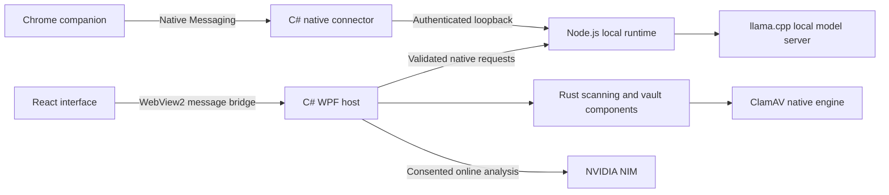

# Architecture

## Current Windows application

The shipped desktop shell is C# WPF with Microsoft Edge WebView2 hosting React/TypeScript. Earlier Tauri planning documents remain historical requirements; they do not describe the current installed window.

The Rust inspection core includes YARA-X, SHA-256 matching and static heuristics. The persistent native protection worker uses the official signature-engine path. Different workflows do not necessarily execute every inspection layer.

Account metadata browsing, secret access and mutations have separate authority requirements. AES-256-GCM protects vault contents; Windows DPAPI protects the per-user secret, and Windows Hello authorizes sensitive operations. AI chat history uses a separate per-user DPAPI-protected store.

Browser adapters extract supported visible message content locally. Findings and authenticated references flow to local analysis and the console. The native AI inbox waits for interface readiness and retains a consumed handoff until the interface acknowledges receipt. This is an in-process retry mechanism, not a durable exactly-once queue across machine crashes.

## Source map

| Directory | Responsibility |
|---|---|
| `apps/ui` | React console and shared extension vault interface |
| `apps/desktop` | WPF/WebView2 host, Windows integration, native connector and installer |
| `apps/demo-runtime` | Local orchestration, authenticated routes and AI lifecycle; legacy directory name |
| `apps/extension` | Manifest V3 companion, content adapters and browser controls |
| `crates` | Rust scanning, contracts, quarantine, USB and runtime foundations |
| `packages/contracts` | Generated TypeScript contracts |
| `tools` | Build, verification, packaging and explicitly gated qualification tools |

See [SECURITY.md](../SECURITY.md) for trust boundaries and known limitations. A separate worker process is not automatically a restricted security sandbox.
